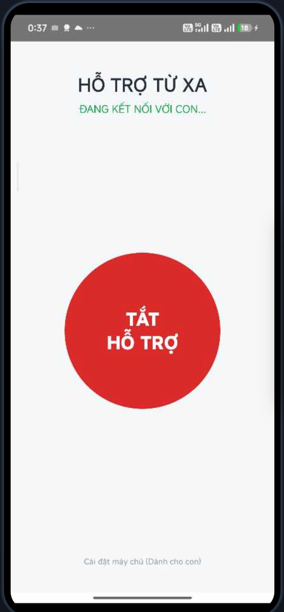
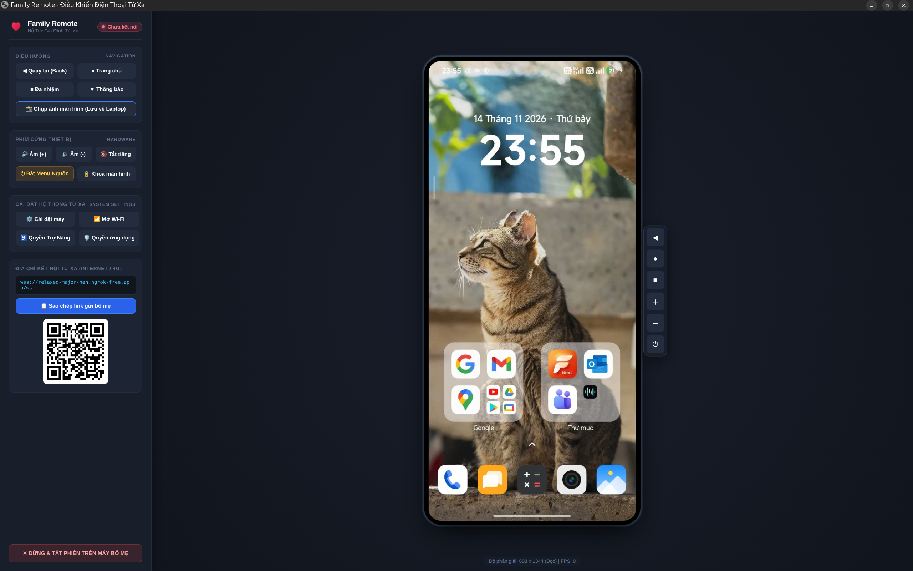

# Family Remote (Hỗ Trợ Gia Đình - Android App)

Ứng dụng Android Native hỗ trợ người thân điều khiển màn hình điện thoại từ xa an toàn, trực quan thông qua ứng dụng máy tính [FamilyServerGo](https://github.com/trinhquyetchien/FamilyServerGo).

---

## 📸 Giao Diện Ứng Dụng

| 📱 Màn Hình Android (Bố Mẹ) | 💻 Giao Diện Điều Khiển Linux (Con) |
| :---: | :---: |
|  |  |

---

## ✨ Tính Năng Nổi Bật

### 1. Dành cho Bố Mẹ (1 Chạm Tối Giản)
- **Thiết kế tối giản:** Chỉ có đúng **1 nút tròn lớn** trung tâm: **[ BẬT HỖ TRỢ ]** / **[ TẮT HỖ TRỢ ]**.
- **Không cần cấu hình phức tạp:** Tự động kết nối tới máy chủ của con qua cơ chế **Cloudflare Tunnel & GitHub Gist Discovery** trong 0.2 giây.
- **Bảo vệ ứng dụng ngân hàng:** Tự động hủy quyền trợ năng (`disableSelf`) ngay khi tắt phiên hỗ trợ, giúp bố mẹ mở các app ngân hàng (Vietcombank, MB, Techcombank,...) an toàn mà không bị chặn bảo mật.

### 2. Dành cho Con (Điều Khiển Qua Máy Tính)
- **Tương tác chuột tự nhiên:** Nhấp chuột (Click) để chạm (Tap), kéo chuột (Drag) để vuốt lướt màn hình (Swipe).
- **Phím chức năng:** Đầy đủ phím Back, Home, Đa nhiệm (Recents), Thanh thông báo, Phím nguồn, Khóa máy, Tăng/Giảm âm lượng.
- **Tự động thích ứng xoay:** Khi bố mẹ xoay ngang/dọc điện thoại, luồng hiển thị trên máy con tự động đổi khung nhìn mà không hề bị ngắt kết nối.
- **Chủ động ngắt phiên:** Nút **"✕ Dừng Phiên"** cho phép con chủ động đóng phiên và tắt quyền trợ năng trên máy bố mẹ từ xa khi đã hỗ trợ xong.

---

## 🛠️ Công Nghệ Sử Dụng

- **Ngôn ngữ:** Kotlin
- **Giao diện:** Jetpack Compose & Material 3
- **Quay & Truyền màn hình:** Android `MediaProjection` API + OkHttp WebSocket (truyền mảng byte JPEG nhị phân tốc độ cao, trần 25 FPS mượt mà)
- **Thao tác cử chỉ hệ thống:** Android `AccessibilityService` (`dispatchGesture`, `performGlobalAction`)
- **Tự động nhận diện mạng:** GitHub Gist API Discovery + Cloudflare Edge Tunnel

---

## 🚀 Cài Đặt & Biên Dịch

### Tải bản cài đặt sẵn (APK)
Tải file `FamilyRemote-v*.apk` mới nhất từ mục [Releases](https://github.com/trinhquyetchien/FamilyRemote/releases).

### Biên dịch từ mã nguồn
```bash
# Kiểm tra Unit Test
./gradlew testDebugUnitTest

# Biên dịch bản Debug APK
./gradlew assembleDebug

# Biên dịch bản Release APK
./gradlew assembleRelease
```
File APK hoàn thiện sẽ nằm tại: `app/build/outputs/apk/debug/app-debug.apk`.

---

## 🔗 Dự Án Liên Quan

- **[FamilyServerGo](https://github.com/trinhquyetchien/FamilyServerGo):** Máy chủ WebSocket Relay Server hiệu năng cao & Ứng dụng Desktop Native Client chạy trên Linux/macOS/Windows.
